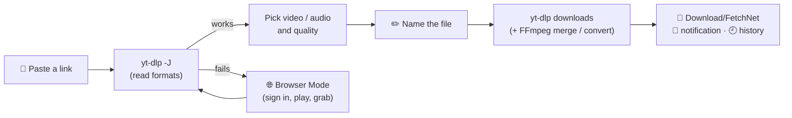
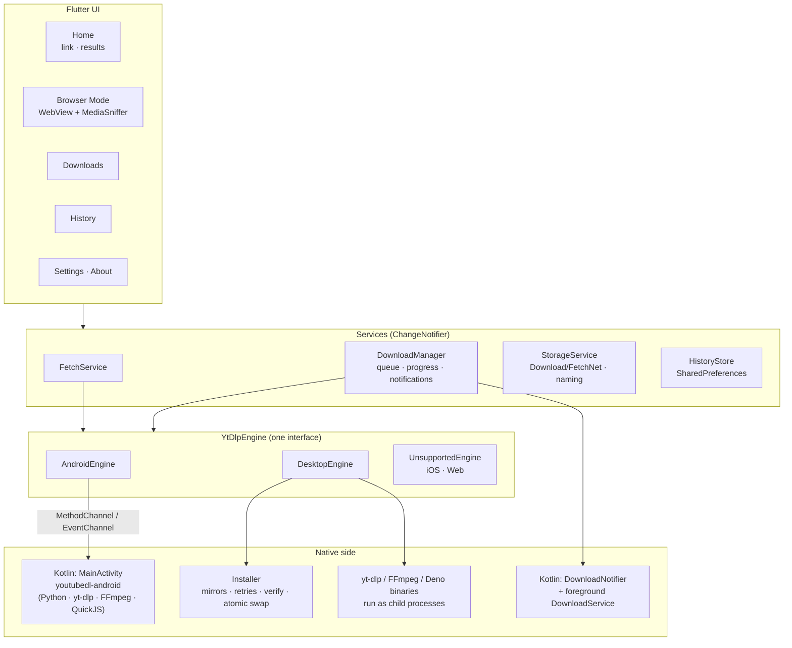

<div align="center">


# FetchNet

**A beautifully simple, cross-platform audio & video downloader, powered by [yt-dlp](https://github.com/yt-dlp/yt-dlp).**

Paste a link. Pick a quality. Done.

[](https://flutter.dev)
[](https://dart.dev)
[](https://github.com/yt-dlp/yt-dlp)
[](#-installation)
[](#-installation)
[](#%EF%B8%8F-building-from-source)
[](#-ai-assisted-development)

[**🌐 Website**](https://fetchnet.arijeet.in) &nbsp;·&nbsp;
[**⬇️ Download**](https://fetchnet.arijeet.in) &nbsp;·&nbsp;
[**🛠️ Build from source**](#%EF%B8%8F-building-from-source) &nbsp;·&nbsp;
[**⚖️ Disclaimer**](#%EF%B8%8F-disclaimer)

</div>

> [!IMPORTANT]
> FetchNet is **only a graphical interface** for the open-source command-line tool yt-dlp. It does not host, store or distribute any media. You alone are responsible for what you download. Only download content you own, that is in the public domain, or that you have permission to download. Read the full [disclaimer](#%EF%B8%8F-disclaimer).

---

## 📑 Table of contents

- [✨ Features](#-features)
- [🖥️ Platform support](#%EF%B8%8F-platform-support)
- [🧭 How it works](#-how-it-works)
- [🏗️ Architecture](#%EF%B8%8F-architecture)
- [🧠 Design decisions](#-design-decisions)
- [🤖 AI-assisted development](#-ai-assisted-development)
- [📦 Installation](#-installation)
- [🛠️ Building from source](#%EF%B8%8F-building-from-source)
- [🩺 Troubleshooting](#-troubleshooting)
- [⚖️ Disclaimer](#%EF%B8%8F-disclaimer)
- [🙏 Credits & acknowledgements](#-credits--acknowledgements)
- [📄 License](#-license)
- [👤 Author & contact](#-author--contact)

---

## ✨ Features

| | |
|---|---|
| 🔗 **Paste any link** | YouTube and the thousands of other sites [supported by yt-dlp](https://github.com/yt-dlp/yt-dlp/blob/master/supportedsites.md). Links shared to FetchNet from other Android apps open straight in it. |
| 🎚️ **Pick your quality** | Video from 144p up to 4K (merged to MP4), or audio as MP3 (320/192/128 kbps), M4A, or the original stream without re-encoding. |
| ✏️ **Name it first** | Every download asks for a file name (pre-filled with the title), offers a random name, and warns before overwriting. |
| 🌐 **Browser Mode** | Pages that can't be read directly open in a built-in browser. FetchNet finds the video and audio playing on the page, tells them apart by looking inside the files, and passes your browser sign-in to yt-dlp. |
| 🔔 **Live notifications** | Chrome-style per-download notifications with progress, speed and Cancel, promoted to a **Live Update** on Android 16. When done, they turn into "Download complete" with Open and Share. |
| 📁 **Saved where you expect** | `Download/FetchNet` on Android (videos appear in your gallery, audio in music apps), `~/Downloads/FetchNet` on desktop. |
| 🕘 **History** | Every download is remembered, with search and filters. The Downloads tab shows what's in progress and the files still in your FetchNet folder. |
| 🔄 **Self-updating engine** | yt-dlp updates itself daily (optional). On desktop, FFmpeg and a JavaScript runtime install in one click, with mirrors, retries and verification. |
| 🎨 **Made to look good** | Violet-gradient design, light / dark / system themes, a floating liquid-glass navbar on phones, a side rail on desktop, and smooth custom animations everywhere. |
| 🪶 **Lightweight** | No state-management framework and no analytics. Desktop installers stay small because the engine downloads on first launch. |

---

## 🖥️ Platform support

| Platform | Status | Engine | Browser Mode |
|---|---|---|---|
|  **Android 7.0+** | ✅ Supported | yt-dlp, Python, FFmpeg & QuickJS bundled in the app | ✅ Android WebView |
|  **Windows 10 / 11** | ✅ Supported | yt-dlp downloaded on first launch; FFmpeg & Deno one click | ✅ WebView2 |
|  **macOS** | 🧪 Builds from source, not yet tested on hardware | Same as Windows | ✅ WKWebView |
|  **Linux** | 🧪 Builds from source, not yet tested on hardware | Same as Windows | ✅ WPE WebKit |
| **iOS** | ❌ Not possible | iOS doesn't allow apps to run yt-dlp | — |
| **Web** | ❌ Not possible | Browsers can't run yt-dlp | — |

---

## 🧭 How it works

FetchNet never downloads anything by itself. It asks **yt-dlp** what a link contains, shows you the choices, and then tells yt-dlp exactly what to fetch, while it tracks progress and files the result.



1. **Read.** `yt-dlp -J` returns a JSON description of the media. FetchNet turns it into clean options, such as "1080p · 60 fps · MP4 · ~120 MB" or "MP3 · 320 kbps".
2. **Choose and name.** You pick a format and a file name. FetchNet builds the exact yt-dlp format selector for it.
3. **Download.** yt-dlp runs with a machine-readable progress template, so FetchNet can show live speed, ETA and stages ("Merging video and audio…").
4. **Finish.** The file lands in your FetchNet folder and gets registered with the system's media library (gallery and music apps). A notification and the history are updated.

---

## 🏗️ Architecture



<details>
<summary><b>📂 Project structure</b></summary>

```
lib/
├── main.dart                  # boot: prefs, device facts, services
├── app.dart                   # MaterialApp, themes, onboarding gate
├── core/
│   ├── app_prefs.dart         # typed SharedPreferences
│   ├── app_services.dart      # service container + AppScope
│   ├── theme.dart             # violet light / dark themes
│   ├── format.dart            # bytes, speed, ETA, URL helpers
│   └── platform/              # device environment, native bridge
├── engine/
│   ├── engine.dart            # YtDlpEngine interface, errors, hints
│   ├── android_engine.dart    # Kotlin bridge (youtubedl-android)
│   ├── desktop_engine.dart    # yt-dlp as a child process
│   └── installer.dart         # robust downloads / installs / updates
├── models/                    # MediaInfo (parses yt-dlp -J), downloads, history
├── services/                  # fetch, download manager, storage, history
├── features/
│   ├── onboarding/            # Welcome → Disclaimer flow
│   ├── home/                  # link card, results, rename dialog, engine banner
│   ├── browser/               # in-app browser + media sniffer
│   ├── downloads/ history/ settings/ shell/
└── widgets/                   # logo, loaders, liquid nav bar, toasts, dialogs

android/app/src/main/kotlin/com/fetchnet/
├── MainActivity.kt            # engine + platform channels, share intents
├── DownloadNotifier.kt        # Chrome-style live / finished notifications
└── DownloadService.kt         # foreground service pinned to a live notification
```

</details>

**Key pieces**

| Component | What it does |
|---|---|
| `YtDlpEngine` | One interface (`run`, `start`, `cancel`, `update`, `installComponent`) with Android, desktop and unsupported implementations, so the UI never cares where yt-dlp lives. |
| `MediaInfo` | Turns yt-dlp's JSON into ranked video and audio options and builds the exact format selector for each. FFmpeg availability decides whether HD (merged) formats are offered. |
| `DownloadManager` | Up to 3 concurrent downloads. Parses a custom `--progress-template`, tracks the video and audio parts of a merge, writes history, and drives the notifications. |
| `MediaSniffer` | Browser Mode's detector. It uses element and request types, `mime=` hints, extensions, light HEAD probes, and a peek inside the media itself (MP4 track handlers, WebM codec IDs, HLS/DASH manifests) to separate video from audio. |
| `Installer` | Mirrors and retries with resume, stall detection, OS-native unpacking, test-runs every binary, then swaps it in atomically (even while the old one is running on Windows). |
| `DownloadNotifier` | One live notification per download (an Android 16 Live Update with a status-bar chip), which turns into "Download complete" (Open / Share) or "Download failed" in place. |

---

## 🧠 Design decisions

<details open>
<summary><b>Why yt-dlp, and why not reimplement it?</b></summary>

Sites change constantly, and yt-dlp's community keeps up with them better than any single app could. FetchNet stays a thin, friendly layer and keeps the engine **updatable at runtime**: daily auto-update, plus a manual button in Settings.
</details>

<details>
<summary><b>Android: bundle Python + yt-dlp via youtubedl-android</b></summary>

Android can't run the desktop yt-dlp binary. [youtubedl-android](https://github.com/JunkFood02/youtubedl-android) ships a Python runtime, yt-dlp, FFmpeg and QuickJS (needed for YouTube) as native libraries. That's about 50 MB per CPU architecture, so FetchNet is published as **per-ABI APKs** (`arm64-v8a`, `armeabi-v7a`, `x86_64`), and the About popup recommends the right one for your device.
</details>

<details>
<summary><b>Desktop: download the engine on first launch</b></summary>

Instead of bundling a 20+ MB binary (and an even larger FFmpeg) into every installer, FetchNet downloads the **official** yt-dlp release on first launch and offers FFmpeg and Deno as optional one-click add-ons. Installers stay small, and each component updates independently.
</details>

<details>
<summary><b>Installs that don't fail</b></summary>

Every download has backup sources: yt-dlp stable → nightly; FFmpeg from yt-dlp's builds → BtbN → gyan.dev; Deno from GitHub → dl.deno.land. Downloads retry with backoff and resume from where they stopped. Archives are unpacked with the OS's own tool, and every binary is **test-run before it's installed**. Replacing a binary that's in use works too: the old one is renamed aside, which Windows allows.
</details>

<details>
<summary><b>One progress format for every platform</b></summary>

yt-dlp is started with `--progress-template` and `--print after_move:filepath`, so Android and desktop produce identical, parseable lines. Post-processing progress (merging, converting) goes to stderr, so both platforms merge stderr into the line stream.
</details>

<details>
<summary><b>Browser Mode looks inside the media</b></summary>

Many sites serve audio-only tracks as `.mp4`/`.webm` files labelled `video/mp4`, so file names and headers can't be trusted. FetchNet reads a small slice of each candidate (up to the first 128 KB, plus the last 256 KB for MP4s whose index is at the end) and checks the actual tracks. It also passes the page's cookies, user agent and referer to yt-dlp, so signed-in pages work.
</details>

<details>
<summary><b>Lightweight by choice</b></summary>

State lives in a few `ChangeNotifier` services exposed through an `InheritedWidget`, with no state-management package. Runtime permissions and notifications are written natively in Kotlin instead of pulling in extra plugins. Settings and history use `SharedPreferences`.
</details>

<details>
<summary><b>Files where users expect them</b></summary>

Downloads go to the public `Download/FetchNet` folder (created on first run). Each finished file is registered with Android's MediaScanner, so videos show up in Gallery / Photos and audio in music and file-manager apps. yt-dlp's partial files stay in app-private temp storage until they're complete.
</details>

---

## 🤖 AI-assisted development

FetchNet was built with **AI assistance**. **Claude** (by [Anthropic](https://www.anthropic.com)), working inside **Claude Code**, acted as a pair programmer, under the direction of the author, Arijeet Das.

> [!NOTE]
> AI assistance doesn't change the responsibility model: the [disclaimer](#%EF%B8%8F-disclaimer) applies in full.

---

## 📦 Installation

###  Android

1. Open **[fetchnet.arijeet.in](https://fetchnet.arijeet.in)** on your phone.
2. Pick the APK for your device. **`arm64-v8a`** fits almost every phone made after 2017. If you're unsure, take the universal APK; FetchNet's About popup (Settings → *FetchNet for Android*) later tells you which build is best.
3. Open the downloaded APK. If Android asks, allow **"Install unknown apps"** for your browser or file manager.
4. Launch FetchNet, read the Welcome screen, accept the **Disclaimer**, and you're in.
5. On your first download, allow **notifications** so you can see live progress.

> [!TIP]
> Updating from a build signed with a different key (for example a debug build you made yourself)? Android will refuse with *"App not installed"*. Uninstall the old version first.

###  Windows

1. Download FetchNet for Windows from **[fetchnet.arijeet.in](https://fetchnet.arijeet.in)** and extract or install it.
2. Run `FetchNet.exe`. If SmartScreen shows *"Windows protected your PC"*, choose **More info → Run anyway**. New publishers get this until they build up reputation.
3. On first launch FetchNet downloads the **yt-dlp** engine (~23 MB, one time).
4. For HD video and MP3, click **Install** on the *"Unlock HD video and MP3"* banner to add **FFmpeg**. For full YouTube quality options, install the **JavaScript runtime** (Deno) in Settings → Engine. If Node.js, Deno or Bun is already on your PATH, FetchNet uses it automatically.

Downloads are saved to `%USERPROFILE%\Downloads\FetchNet`.

###  macOS &nbsp;·&nbsp;  Linux

No prebuilt release yet. [Build from source](#%EF%B8%8F-building-from-source) (it takes a few commands). On first launch the engine and add-ons install just as on Windows. Downloads go to `~/Downloads/FetchNet`.

---

## 🛠️ Building from source

### 1. Prerequisites

| Needed for | Requirement |
|---|---|
| **Everything** | [Flutter](https://docs.flutter.dev/get-started/install) **3.47+** (stable) with Dart **3.13+**, and [Git](https://git-scm.com) |
| **Android** | [Android Studio](https://developer.android.com/studio) (its bundled JDK 17 is used), Android SDK Platform **36**, and the NDK version Flutter asks for (installed automatically on the first build) |
| **Windows** | Windows 10/11, [Visual Studio 2022+](https://visualstudio.microsoft.com/) with the **"Desktop development with C++"** workload, and **NuGet** on PATH (needed by the WebView plugin): `winget install Microsoft.NuGet` |
| **macOS** | Xcode (Xcode 26 to compile the Liquid Glass `AppIcon.icon`), CocoaPods: `sudo gem install cocoapods` |
| **Linux** | Flutter's Linux toolchain plus WPE WebKit for Browser Mode. On Ubuntu/Debian, for example: `sudo apt install clang cmake ninja-build pkg-config libgtk-3-dev liblzma-dev libstdc++-12-dev libwpewebkit-1.0-dev libwpe-1.0-dev libepoxy-dev` |

Check your setup:

```bash
flutter doctor -v
```

### 2. Clone

```bash
git clone https://github.com/arijeetdas/FetchNet.git
cd FetchNet
```

### 3. Get dependencies

```bash
flutter pub get
```

### 4. Run in debug mode

```bash
flutter devices                 # list connected phones / emulators / desktops
flutter run                     # pick a device, or:
flutter run -d windows          # Windows desktop
flutter run -d macos            # macOS desktop
flutter run -d linux            # Linux desktop
flutter run -d <device-id>      # a specific Android phone or emulator
```

> [!TIP]
> On Android, enable **Developer options → USB debugging** on the phone and accept the prompt when you connect it. The first Android build downloads Gradle and SDK components, so it can take several minutes.

### 5. Build releases

<details open>
<summary><b>Android: per-ABI APKs (recommended) and a universal APK</b></summary>

```bash
flutter build apk --release --split-per-abi
flutter build apk --release
```

Output: `build/app/outputs/flutter-apk/`
`app-arm64-v8a-release.apk` · `app-armeabi-v7a-release.apk` · `app-x86_64-release.apk` · `app-release.apk` (universal)

</details>

<details>
<summary><b>Android: signing your release</b></summary>

Without a keystore, release builds are signed with the debug key. To sign properly:

1. **Create a keystore (once):**
   ```powershell
   New-Item -ItemType Directory -Force "$env:USERPROFILE\keys" | Out-Null
   keytool -genkeypair -v -keystore "$env:USERPROFILE\keys\fetchnet-release.jks" -alias fetchnet -keyalg RSA -keysize 4096 -validity 10000
   ```
   `keytool` ships with Android Studio, in `<Android Studio>\jbr\bin`.
2. **Create `android/key.properties`** (it's git-ignored):
   ```properties
   storePassword=YOUR_PASSWORD
   keyPassword=YOUR_PASSWORD
   keyAlias=fetchnet
   storeFile=C:/Users/YOU/keys/fetchnet-release.jks
   ```
3. **Reference it from `android/app/build.gradle.kts`** with a `signingConfigs { create("release") { … } }` block. See the [Flutter guide](https://docs.flutter.dev/deployment/android#sign-the-app).
4. **Build and verify:**
   ```bash
   apksigner verify --verbose --print-certs build/app/outputs/flutter-apk/app-arm64-v8a-release.apk
   ```

> [!CAUTION]
> Back up the keystore and its password. If you lose them, you can never publish an update that installs over the existing app.

</details>

<details>
<summary><b>Windows</b></summary>

```powershell
flutter build windows --release
```

Output: `build\windows\x64\runner\Release\`. Ship the **whole folder** (the `.exe`, its DLLs and the `data` folder).

To code-sign it, sign every unsigned `.exe`/`.dll` with `signtool`:

```powershell
signtool sign /fd SHA256 /sha1 <CERT_THUMBPRINT> /tr http://timestamp.digicert.com /td SHA256 /d "FetchNet" build\windows\x64\runner\Release\FetchNet.exe
```

</details>

<details>
<summary><b>macOS</b></summary>

```bash
flutter build macos --release
```

Output: `build/macos/Build/Products/Release/FetchNet.app`. To distribute it outside the App Store, sign it with a *Developer ID Application* certificate, then notarize it with `xcrun notarytool` and staple it.

</details>

<details>
<summary><b>Linux</b></summary>

```bash
flutter build linux --release
```

Output: `build/linux/x64/release/bundle/`. Run `./fetchnet` from inside that folder.

</details>

### 6. Quality checks

```bash
flutter analyze      # static analysis
flutter test         # unit tests (format parsing, file naming, media sniffing, loader motion)
```

### 7. Regenerating icons

All app icons (Android adaptive and themed, iOS/macOS asset catalogs and `AppIcon.icon` bundles, Windows `.ico`, Linux, web) were generated from `assets/app_icon/foreground.png`. It was traced into vector paths (`assets/app_icon/glyph.svg`), so every size stays crisp. The README icon lives in `docs/images/` and isn't bundled into the app.

---

## 🩺 Troubleshooting

<details>
<summary><b>"Couldn't get this media" / "Unsupported URL"</b></summary>

Try **Browser Mode**: open the page, sign in if needed, press play, then tap **Grab this page** or pick the file under **Media found**. On desktop you can also use **"Use browser sign-in"** to reuse cookies from Firefox, Chrome, Edge and others.
</details>

<details>
<summary><b>A site that used to work suddenly fails</b></summary>

The site probably changed. Go to **Settings → Engine → Update** to fetch the latest yt-dlp (and keep "Keep yt-dlp up to date" on).
</details>

<details>
<summary><b>Only low qualities (360p) on desktop</b></summary>

HD on YouTube and many other sites comes as separate video and audio streams that need **FFmpeg** to merge. Install it from the Home banner or Settings → Engine. For YouTube, also install the **JavaScript runtime**.
</details>

<details>
<summary><b>Windows build: "Nuget is not installed!"</b></summary>

`winget install Microsoft.NuGet`, then restart your terminal (so the new PATH is picked up) and build again.
</details>

<details>
<summary><b>Android build: "Could not close incremental caches"</b></summary>

This is a Kotlin bug that happens when the project and the pub cache are on different drives. The repo already sets `kotlin.incremental=false` in `android/gradle.properties`. If you still see it, run `cd android && ./gradlew --stop` and build again.
</details>

<details>
<summary><b>Android: "App not installed"</b></summary>

An installed copy is signed with a different key. Uninstall it and install the new APK.
</details>

---

## ⚖️ Disclaimer

> [!WARNING]
> **Please read carefully.** You accept these terms inside the app before you can use it.

1. **FetchNet is only an interface.** FetchNet is a graphical user interface for yt-dlp, an independent open-source command-line program. FetchNet does not host, store, index, upload or distribute any media. It is not affiliated with, endorsed by, or connected to yt-dlp or to any website or service whose content can be reached through it.
2. **No support for unlawful use.** FetchNet does not encourage, promote or condone copyright infringement, piracy, circumvention of technical protection measures, violation of any website's terms of service, or any other illegal or harmful activity.
3. **You are solely responsible.** You alone are responsible for how you use FetchNet and for anything you download with it. Only download content that you own, that is in the public domain, that is licensed for downloading, or that you have clear permission from the rights holder to download. Make sure your use complies with copyright law and every other law and regulation that applies to you, as well as the terms of the services you access.
4. **No warranty, no liability.** FetchNet is provided "as is", without warranty of any kind. The developer accepts no liability for any misuse of the app, or for any legal claims, damages, data loss, account restrictions or other consequences arising from its use.
5. **Third-party content.** All videos, music, trademarks and other content remain the property of their respective owners.

---

## 🙏 Credits & acknowledgements

FetchNet stands on the shoulders of these projects. Thank you to everyone who builds and maintains them. ❤️

### The engine

| Project | Role in FetchNet | License |
|---|---|---|
| [**yt-dlp**](https://github.com/yt-dlp/yt-dlp) | The heart of FetchNet: site support, format selection, downloading | Unlicense |
| [**youtubedl-android**](https://github.com/JunkFood02/youtubedl-android) (originally by [yausername](https://github.com/yausername/youtubedl-android)) | Runs yt-dlp on Android, with bundled Python, FFmpeg and QuickJS | GPL-3.0 |
| [**FFmpeg**](https://ffmpeg.org) | Merging video and audio, converting to MP3/M4A, metadata | LGPL-2.1+ / GPL-2.0+ (depending on the build) |
| [**yt-dlp/FFmpeg-Builds**](https://github.com/yt-dlp/FFmpeg-Builds), [**BtbN/FFmpeg-Builds**](https://github.com/BtbN/FFmpeg-Builds), [**gyan.dev**](https://www.gyan.dev/ffmpeg/builds/), [**martin-riedl.de**](https://ffmpeg.martin-riedl.de) | Prebuilt FFmpeg binaries downloaded by the desktop app | MIT (build scripts); FFmpeg's own license for binaries |
| [**Python**](https://www.python.org) | Runs yt-dlp on Android (via youtubedl-android) | PSF License |
| [**QuickJS**](https://bellard.org/quickjs/) | JavaScript runtime yt-dlp uses for YouTube on Android | MIT |
| [**Deno**](https://github.com/denoland/deno) | Optional JavaScript runtime for YouTube on desktop | MIT |

### Framework & packages

| Package | Used for | License |
|---|---|---|
| [**Flutter**](https://github.com/flutter/flutter) & [**Dart**](https://dart.dev) | The whole cross-platform app | BSD-3-Clause |
| [shared_preferences](https://pub.dev/packages/shared_preferences) | Settings, onboarding state, download history | BSD-3-Clause |
| [path_provider](https://pub.dev/packages/path_provider) | App-support, temp and Downloads folders | BSD-3-Clause |
| [url_launcher](https://pub.dev/packages/url_launcher) | Opening links and files in the system browser / apps | BSD-3-Clause |
| [package_info_plus](https://pub.dev/packages/package_info_plus) | Showing the installed version | BSD-3-Clause |
| [flutter_svg](https://pub.dev/packages/flutter_svg) | The app glyph and platform logos | MIT |
| [flutter_inappwebview](https://pub.dev/packages/flutter_inappwebview) | Browser Mode's in-app browser and cookie access | Apache-2.0 |
| [archive](https://pub.dev/packages/archive) | Fallback unpacking of FFmpeg/Deno downloads | MIT |
| [path](https://pub.dev/packages/path) | Cross-platform path handling | BSD-3-Clause |
| [cupertino_icons](https://pub.dev/packages/cupertino_icons) | iOS-style icon font | MIT |
| [flutter_lints](https://pub.dev/packages/flutter_lints) | Lint rules (development only) | BSD-3-Clause |
| [AndroidX Core](https://developer.android.com/jetpack/androidx/releases/core) | Notifications, Live Updates, foreground service helpers | Apache-2.0 |
| [Material Icons](https://fonts.google.com/icons) | UI icons | Apache-2.0 |

### Platform web engines

[Android System WebView](https://developer.chrome.com/docs/webview), [Microsoft Edge WebView2](https://developer.microsoft.com/microsoft-edge/webview2/) (Windows), WKWebView (Apple platforms) and [WPE WebKit](https://wpewebkit.org) (Linux) power Browser Mode.

### Tools used during development

[potracer](https://pypi.org/project/potracer/) (GPL-2.0+, a Python port of Peter Selinger's [Potrace](https://potrace.sourceforge.net)) traced the app icon into vector paths, and [Pillow](https://python-pillow.org) rendered the raster icons. Both were used only at development time and aren't shipped with the app.

### Trademarks

Android, Windows, macOS, iOS, Linux, YouTube and all other product names, logos and brands are the property of their respective owners. They're used only to identify platforms and services, and don't imply endorsement.

---

## 📄 License

A license for FetchNet's own source code hasn't been published yet. Until one is added, all rights are reserved by the author.

> [!NOTE]
> The Android app bundles **youtubedl-android**, which is licensed under **GPL-3.0**. Anyone redistributing FetchNet's Android build must comply with the GPL-3.0 terms of that component (and with FFmpeg's license).

---

## 👤 Author & contact

<div align="center">

**Arijeet Das**

[](https://arijeetdas.in)
[](https://fetchnet.arijeet.in)

[](https://linkedin.arijeet.in)
[](https://github.arijeet.in)

📧 [contact@arijeet.in](mailto:contact@arijeet.in) &nbsp;·&nbsp; 📧 [arijeetdas900@gmail.com](mailto:arijeetdas900@gmail.com)

<br/>


<sub>Made with 💜 using Flutter · Powered by yt-dlp</sub>

</div>
